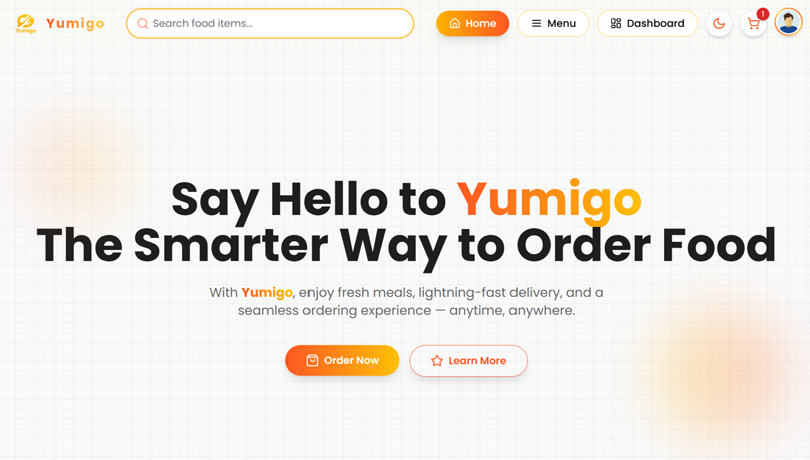
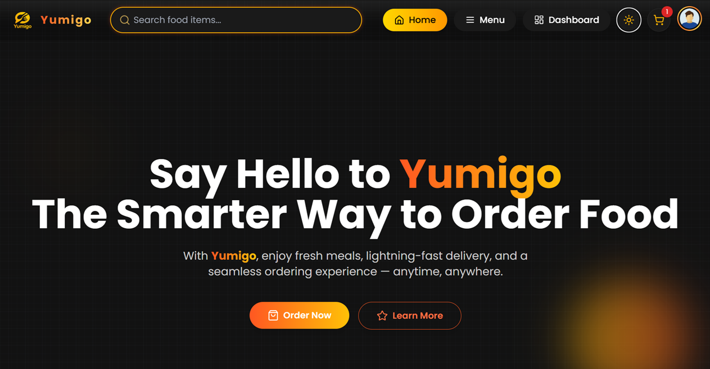

# Yumigo 🍽️

Yumigo is a full-stack food ordering website built using React, Node.js, Express, and MongoDB.

## Live Demo

[View Yumigo](https://yumigo-frontend.onrender.com/)

## Features

- Browse food items by category, price, and sorting options
- Quick View modal for food items
- Add items to cart and save cart data in MongoDB
- User authentication with JWT
- Separate access for users and admins
- Admin dashboard to manage food items, users, and orders
- Dark and light themes
- Responsive design for mobile and desktop
- Loading indicators and animations

## Tech Stack

**Frontend:** React, Vite, Tailwind CSS, React Router, Framer Motion, Axios, Lucide Icons

**Backend:** Node.js, Express.js, MongoDB, Mongoose, JWT

## Screenshots

### Home Page



### Dark Mode



## Run Locally

Clone the repository:

```bash
git clone https://github.com/ankityadav456/mern-food-ordering.git
cd mern-food-ordering
```

Install dependencies in the frontend and backend folders:

```bash
cd frontend
npm install
```

```bash
cd backend
npm install
```

Create the required `.env` files and configure your MongoDB connection and other environment variables.

Start the frontend and backend using the scripts defined in their respective `package.json` files.

## Author

Built by Ankit Yadav.
